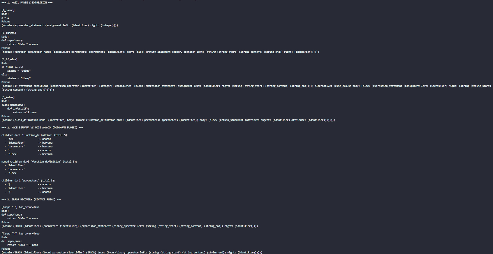
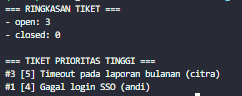
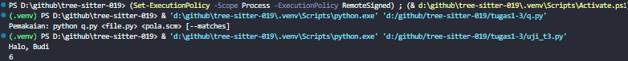

# Laporan Tugas Awal: Memahami Tree-sitter

- **Nama / NIM:** _Luis Danang Pambudi/251524019_
- **Kelas:** _2A-D4_
- **Repositori GitHub:** `019_2A_Luis-Danang-Pambudi_Tree-Sitter9`

---

## 1. Ringkasan Tiap Tugas

### Tugas 1 — Membaca Pohon (`tugas1-3/t1.py`)

Skrip `t1.py` mem-parse potongan kode Python dasar (`x = 1`), fungsi (`def sapa`), percabangan `if`/`else`, dan kelas dengan satu method (`class Mahasiswa`). Sebelum dijalankan, bentuk pohon diperkirakan terlebih dahulu lalu dibandingkan dengan output S-expression `tree.root_node` (misalnya literal string di Python ternyata dipecah menjadi `string_start`, `string_content`, `string_end`).

- **Node bernama vs anonim:** Pada `function_definition`, `children` berisi 5 node (`def`, `identifier`, `parameters`, `:`, `block`), sedangkan `named_children` hanya 3 node. Node anonim yang tersembunyi antara lain `'def'`, `':'`, `'('`, dan `')'`.
- **Error recovery:** Menghapus `:` atau `)` membuat `has_error=True` dan memunculkan node `(ERROR ...)` tanpa membuat parser berhenti.

> \*
>
>    

---

### Tugas 2 — Penjelajah Node (`tugas1-3/jelajah.py`)

Skrip `jelajah.py` menelusuri pohon sintaks secara rekursif memakai `enumerate(node.children)`, menyaring node anonim (`is_named`), lalu mencetak indentasi kedalaman, label field (`field_name_for_child(i)`), tipe node, dan posisi `[baris:kolom]`. Versi pengayaan dengan `TreeCursor` (`--cursor`) juga dibuat. Pengujian pada `kecil.py` dan `contoh_100_baris.py` (103 baris) menghasilkan 717 baris output yang identik antara versi rekursif dan `TreeCursor`.

> 
>
>    

---

### Tugas 3 — Query Pertama (`tugas1-3/q.py` & `*.scm`)

Dibuat penjalan query `q.py` yang mendukung `captures()` dan `matches()`, serta empat query:

1. `fungsi.scm` — menangkap nama fungsi dan jumlah parameternya (`named_child_count`).
2. `print.scm` — menangkap pemanggilan `print(...)` dengan predikat `(#eq? @fn "print")`.
3. `import.scm` — menangkap nama modul dari `import ...`, `import ... as ...`, dan `from ... import ...` setelah mengecek nama node asli (`import_statement`, `aliased_import`, `import_from_statement`) lewat `jelajah.py`.
4. `docstring.scm` _(pengayaan)_ — menangkap string pada anak pertama `block` fungsi memakai anchor `.`.

Hasil query pada `uji_t3.py` cocok 100% dengan hitungan manual (3 fungsi, 3 `print`, 4 modul import, 2 docstring).

> 
>
>    

---

### Tugas 4 — Grammar DSL Filter (`tree-sitter-filter/`)

Grammar DSL filter dibangun bertahap di `grammar.js` (langkah 4a–4f): mulai dari perbandingan tunggal, operator perbandingan & `number`, `_expr` + `and_expression` + `word: $ => $.identifier`, `or_expression` dengan `prec.left`, `parenthesized`, `not_expression` + `boolean`, hingga `field(...)`. Setelah itu ditambahkan `in_expression` (dengan `value_list`) untuk daftar nilai dan operator `contains` untuk pencarian teks. Seluruh 7 kasus uji di `test/corpus/dasar.txt` lulus 100% saat menjalankan `tree-sitter test`, termasuk prioritas `a = 1 or b = 2 and c = 3` dan `in` dengan tiga nilai.

>    

---

### Tugas 5 — Highlight DSL Filter (`tree-sitter-filter/queries/highlights.scm`)

File `queries/highlights.scm` memetakan kata kunci (`and`, `or`, `not`, `in`, `contains`) ke `@keyword`, operator perbandingan ke `@operator`, string/angka/boolean ke `@string`/`@number`/`@constant.builtin`, dan nama field pada `comparison` serta `in_expression` ke `@property`. Pengujian dengan `tree-sitter query` dan `tree-sitter highlight contoh.filter` memastikan seluruh jenis token terwarnai dengan benar.

>    

---

### Tugas 6 — Mini Proyek: Pendeteksi TODO & Fungsi Panjang (`cek/cek.py`)

CLI `cek.py <folder>` menggabungkan tiga pemeriksaan: komentar `TODO`/`FIXME` (`#match?`), fungsi $> 30$ baris (`end_point[0] - start_point[0] + 1`), dan deteksi file dengan error sintaks (`has_error` + posisi node error pertama). Folder `.git/`, `.venv/`, `node_modules/`, dan `__pycache__/` dilewati, serta ditambahkan dukungan file `.js` (`tree-sitter-javascript`).
Pengujian pada repositori nyata `pallets/itsdangerous` (15 file Python) melaporkan 1 `TODO`, 6 fungsi $> 30$ baris, dan 0 error. Pengecekan manual pada 2 file (`url_safe.py` fungsi `load_payload` baris 23–53 = 31 baris; `timed.py` `# TODO` baris 182 dan `loads` baris 185–220 = 36 baris) cocok sepenuhnya.

>    

---

## 2. Kendala dan Cara Mengatasinya

| No  | Kendala                                                                          | Penyebab                                                                                   | Solusi                                                                                                                              |
| --- | -------------------------------------------------------------------------------- | ------------------------------------------------------------------------------------------ | ----------------------------------------------------------------------------------------------------------------------------------- |
| 1   | `tree-sitter init` gagal (`IO error: not a terminal`) & `gcc.exe` lama error DLL | Terminal non-interaktif tidak mendukung prompt `init`, dan `MinGW` lama tidak kompatibel   | Membuat `tree-sitter.json` secara langsung sesuai skema CLI 0.27 dan memakai compiler yang dikenali `tree-sitter`                   |
| 2   | `Unresolved conflict` saat `tree-sitter generate` di Tugas 4c                    | `and_expression` dan `or_expression` belum punya prioritas/asosiativitas                   | Menambahkan `prec.left(1, ...)` pada `or`, `prec.left(2, ...)` pada `and`, `prec(3, ...)` pada `not`, dan `word: $ => $.identifier` |
| 3   | `Bad JSON config` saat menjalankan `tree-sitter highlight` di Tugas 5            | `Set-Content -Encoding UTF8` di PowerShell 5.1 menambahkan UTF-8 BOM di awal `config.json` | Menulis `config.json` dalam UTF-8 tanpa BOM memakai `[System.IO.File]::WriteAllText`                                                |

---

## 3. Catatan Penggunaan AI

AI coding agent dipakai sepanjang pengerjaan untuk: (a) **penjelasan materi & rincian langkah tugas** sebelum mulai menulis kode, (b) **brainstorming** rancangan struktur grammar `in_expression`/`contains` serta struktur CLI `cek.py`, dan (c) **validasi kode/query** terhadap pohon hasil parse.

### Kesalahan / Kekurangan Hasil AI yang Ditemukan & Bukti Verifikasinya

1. **Kesalahan posisi error pada `cari_error_pertama()` di Tugas 6 (`cek/cek.py`):**
   - **Permintaan ke AI:** Membuat fungsi rekursif untuk menemukan baris pertama kesalahan sintaks saat `tree.root_node.has_error` bernilai `True`.
   - **Kesalahan hasil AI:** Versi awal memeriksa `if node.is_error or node.is_missing: return node` sebelum menelusuri `node.children`. Akibatnya, saat diuji pada `cek/uji/sintaks_rusak.py` (docstring di baris 1, kesalahan `def rusak(a, b)` tanpa `:` di baris 4), program melaporkan `[ERR ] cek\uji\sintaks_rusak.py:1:0` (salah baris).
   - **Bukti verifikasi & perbaikan:** Pohon `sintaks_rusak.py` dicek dengan `jelajah.py` dari Tugas 2; terlihat node `ERROR [1:0]` membungkus node `ERROR [4:0]` yang lebih spesifik. Setelah urutan traversal diubah agar turun ke child terlebih dahulu baru mengembalikan `node`, pengujian ulang langsung melaporkan `[ERR ] cek\uji\sintaks_rusak.py:4:0` (tepat pada baris yang rusak).

2. **Kesalahan perintah pembuatan `config.json` di PowerShell (Tugas 5):**
   - **Permintaan ke AI:** Menyiapkan konfigurasi `parser-directories` untuk menguji `tree-sitter highlight contoh.filter`.
   - **Kesalahan hasil AI:** AI menyarankan `Set-Content -Encoding UTF8` pada Windows PowerShell 5.1 yang menyisipkan karakter BOM di awal file.
   - **Bukti verifikasi & perbaikan:** `tree-sitter highlight` gagal dengan pesan `Error: Bad JSON config -- expected value at line 1 column 1`. Setelah file ditulis ulang tanpa BOM, `tree-sitter highlight` berjalan normal dan mewarnai seluruh token.
